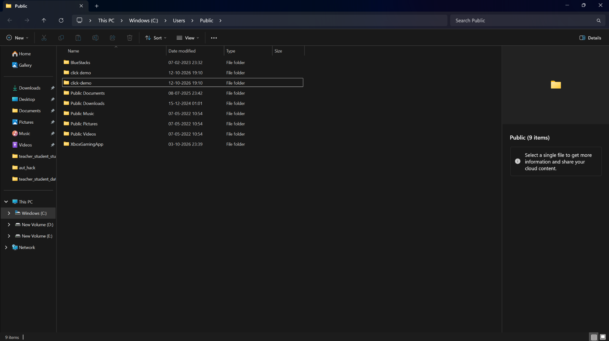
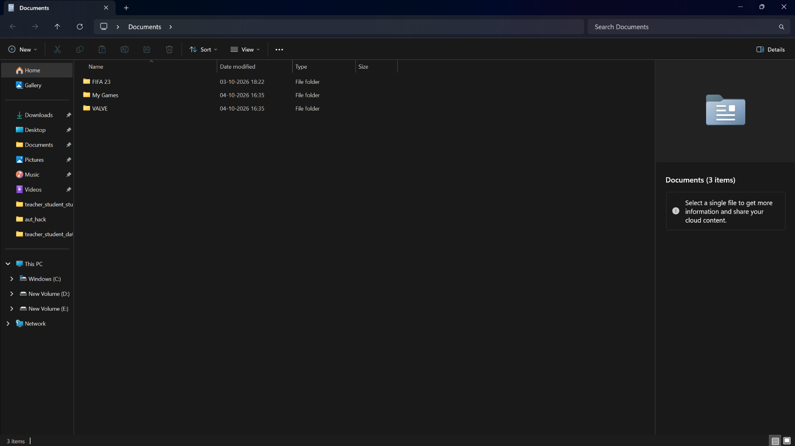
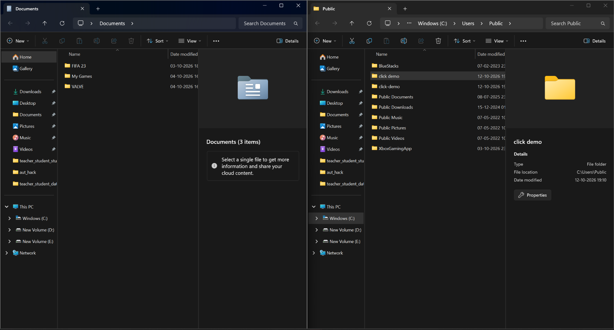
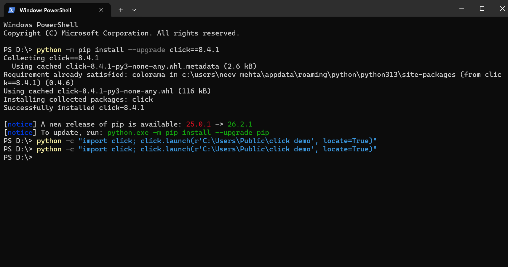
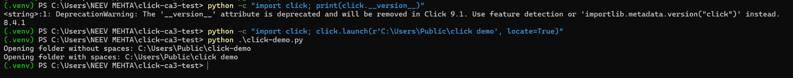

# Investigation of a Windows Folder-Selection Issue in Click

CA-3 Case Study – Open Source Technologies (TE7756), Symbiosis Institute of Technology, Pune, 2026–27

The Word version (`Click_CA3_Case_Study_Report.docx`) is the submission copy and contains the screenshots inline.

## 1. Introduction

Open-source software is developed in public: the source code, bug reports, discussions and code reviews can all be inspected. This case study investigates one real bug in Click, a Python package for building command-line interfaces. The bug affects click.launch(..., locate=True) on Windows when the target path contains a space.

The work follows the CA-3 activities: project identification, repository exploration, issue investigation, bug reproduction, contribution process, pull-request investigation, practical observations and our own contribution. Statements are marked as local observations (what we saw on our machine) or as repository evidence (what the Click source and history show).

Division of work and contribution allocation: Neev Mehta – regression-test patch and final integration (30%); Shivam Dev – issue investigation and reproduction workflow (23%); Pranav Mangla – upstream pull-request and code-diff analysis (23%); Raghvendra Pathe – screenshots, evidence organization and report review (24%). All members should be able to explain the full case study.

## 2. Project Overview

Click (Command Line Interface Creation Kit) is a Python package, maintained by the Pallets project, for creating command-line tools with composable commands, options, arguments, prompts and help pages. It is released under the BSD-3-Clause licence and is widely used as a dependency (for example by Flask).

Besides parsing, Click provides terminal utilities. The one studied here is click.launch(url, wait=False, locate=False), which opens a file or URL in the default application. With locate=True it opens the file manager and selects the file instead of opening it. On Windows this is done by starting Explorer with its /select option.

- Official documentation: https://click.palletsprojects.com/
- Official repository: https://github.com/pallets/click
- Language and layout: pure Python, source under src/click/, tests under tests/, docs under docs/, changelog in CHANGES.rst.
## 3. Repository Investigation

We cloned pallets/click and examined it. The part relevant to this study is the function open_url() in src/click/_termui_impl.py, which launch() calls. It has one branch per platform: macOS runs open -R, Windows runs explorer /select, Cygwin runs cygstart, and other systems use xdg-open.

- Documentation: docs/ (including docs/contributing.md) and the Pallets contributing guides.
- Tests: tests/test_termui.py covers terminal utilities. Before our work it had no test for the Windows locate branch of open_url().
- Activity: the repository is actively maintained, with frequent commits, pull requests and tagged releases (8.4.0, 8.4.1, 8.4.2, 8.5.0 and later).
- Our student repository: https://github.com/neevmehtabtech2024-create/click-ca3-case-study (reproduction script, screenshots, patch, report).
## 4. Issue Investigation

Selected issue: https://github.com/pallets/click/issues/2994 – "launch() cannot locate files with spaces in the name on Windows".

| Item | Detail |
|---|---|
| Problem | click.launch(path, locate=True) on Windows opens the Documents folder instead of selecting the file or folder when the path contains a space. |
| Reporter / date opened | **[fill in from the issue page]** |
| Status | **[fill in from the issue page: open / closed, and date]** |
| Workaround in discussion | Starting Explorer through PowerShell instead of cmd avoids the problem, but the reporter noted this is only a workaround. |
| Maintainer guidance | Maintainer davidism wrote that PowerShell is not needed and that the /select argument must be quoted, with any embedded quotes doubled. |
| Related | PR #3440 (quoting approach), PR #3478 (the fix that was merged), issue #2868 (similar problem without locate=True). |

The issue is a good case study: it is small, reproducible without special hardware, and shows how a maintainer's first suggested fix (quoting) differed from the change that was finally merged (splitting the arguments).

## 5. Bug Investigation and Reproduction

Environment: Windows, Python 3.13.3, PowerShell, a virtual environment, target path C:\Users\Public\click demo (a folder whose name contains a space). A second folder, C:\Users\Public\click-demo (no space), was created as a control.

Steps (script: reproduction/click-demo.py):

```
py -3.13 -m venv .venv
.\.venv\Scripts\Activate.ps1
python -m pip install click==8.2.1
python -c "import click; click.launch(r'C:\Users\Public\click demo', locate=True)"
```

Expected result: Explorer opens C:\Users\Public with the folder click demo selected.

Actual result with Click 8.2.1: Explorer opened the Documents folder; nothing was selected (Figure 2).

The test was then repeated after upgrading (Figure 4):

```
python -m pip install --upgrade click==8.4.1
python -c "import click; print(click.__version__)"
python -c "import click; click.launch(r'C:\Users\Public\click demo', locate=True)"
```

Actual result with Click 8.4.1: Explorer opened C:\Users\Public with click demo highlighted (Figure 3).

| Click version | Target path | Observed in Explorer | Matches expected? |
|---|---|---|---|
| 8.2.1 | C:\Users\Public\click demo | Documents folder opened | No – bug reproduced |
| 8.4.1 | C:\Users\Public\click demo | Public opened, click demo highlighted | Yes |

Why it happens (repository evidence plus a runnable check). On Windows, subprocess joins an argument list into one command-line string with subprocess.list2cmdline(), and wraps any single argument that contains a space in double quotes. In Click 8.2.1 the option and the path were one argument, so the whole thing was quoted, which Explorer does not understand:

```
# reproduction/cmdline-quoting-demo.py (runs on any OS)
Click 8.2.1: explorer "/select,C:\Users\Public\click demo"
Click 8.4.1: explorer /select, "C:\Users\Public\click demo"
```

Only the 8.4.1 form keeps /select, as its own token with the path quoted separately. This explanation is our reading of the code and of Python's documented quoting rule; the screenshots show the symptom, not the cause. The test is manual and was run on one machine, so we do not claim the behaviour on every Windows version.



*Figure 1 – C:\Users\Public containing the two test folders, click demo and click-demo.*



*Figure 2 – Click 8.2.1: Explorer opened Documents instead of selecting click demo (bug).*



*Figure 3 – Click 8.4.1: Explorer opened Public with click demo highlighted (left: the Documents window from the earlier test).*



*Figure 4 – Installing Click 8.4.1 and re-running the launch command in PowerShell.*



*Figure 5 – Terminal showing click.__version__ = 8.4.1 and the run of click-demo.py (the DeprecationWarning is Click announcing that __version__ will be removed in 9.1; it is unrelated to the bug).*

## 6. Contribution Process

Click follows the standard Pallets workflow, documented in docs/contributing.md, which links to the Pallets quick reference and detailed contributing guide. The repository's pull-request template adds these expectations:

- Open an issue first (except for typos and trivial documentation changes) and link it in the PR, for example "fixes #2994".
- Add tests that demonstrate the correct behaviour; the tests should fail without the change.
- Update the relevant documentation and add a .. versionchanged:: note where needed.
- Add an entry to CHANGES.rst that links the issue and the PR.
- Run the test suite and style checks (tox, pre-commit / ruff) before opening the PR.
Typical flow: fork the repository, create a branch, make a focused change with tests, push, open a PR, respond to review, and a maintainer merges. Releases are tagged by the maintainers.

## 7. Pull Request Investigation

Pull request: https://github.com/pallets/click/pull/3478 – "Fix 2994 launch locate files w spaces windows". It fixes issue #2994 and was worked on at a PyCon sprint by Rowlando13.

| Item | Evidence |
|---|---|
| Merged commit | 9b327da, author Rowlando13, 2026-05-19, squash-merged as (#3478) |
| Files changed | 1 file, 1 insertion, 1 deletion: src/click/_termui_impl.py |
| Tests added | None |
| Review | Commented on by kdeldycke and Rowlando13. kdeldycke pointed out the missing changelog entry and added it in commit 5eea580 (2026-05-22): "Fix open_url on Windows when the file path contains spaces. #2994 #3478". |
| Released in | Version 8.4.1 (released 2026-05-21). git confirms tag 8.4.1 contains the commit; 8.2.1 does not. |

The code change (src/click/_termui_impl.py, Windows branch of open_url):

```
- args = ["explorer", f"/select,{url}"]
+ args = ["explorer", "/select,", url]
```

Affected component: only the Windows locate=True path of click.launch(). The macOS, Cygwin and Linux branches and the non-locate Windows branch (os.startfile) are unchanged. Observation: the PR is a minimal fix, and it added no automated test, although the PR template asks for one. We address this in section 9.

## 8. Practical Observations

- Reproducing the bug on an exact version, then re-testing after the upstream fix, is how we confirmed that the fix is in 8.4.1 on our machine.
- The visible symptom (Documents opening) says nothing about the cause; we needed the source, the git history and the command-line string to explain it.
- The first suggestion in the issue (quote the argument) and the merged change (split the arguments) are two different fixes for the same symptom.
- The test depends on Windows Explorer, a manual step on one machine. That is why an automated test that checks the arguments passed to subprocess is more valuable than a screenshot for future maintainers.
- Gap in our evidence: Figure 5 shows version 8.4.1; for the 8.2.1 run we have the Explorer result (Figure 2) but should also keep a screenshot of the pip show click output.
## 9. Changes / Contribution

1. Regression tests (group contribution; implementation lead: Neev Mehta, 30% allocation). Because PR #3478 changed behaviour without a test, the group prepared tests for it. They are in contribution/0001-test-open_url-locate-on-windows.patch and add four test cases to tests/test_termui.py. The tests simulate Windows (WIN = True), replace subprocess.call, and assert that Click passes ["explorer", "/select,", path] for paths without spaces, with a space, and with spaces in several path parts, and that a file:// URL is percent-decoded first.

| Code under test | Result |
|---|---|
| Current Click with the fix | 4 passed |
| Click before the fix (commit 9b327da^) | 4 failed – the tests detect the bug |
| Whole tests/test_termui.py with the new tests | 263 passed, 23 skipped (Linux, Python 3.13) |

2. Reproduction tooling (lead: Shivam Dev, 23% allocation). reproduction/cmdline-quoting-demo.py shows the root cause on any operating system, and reproduction/click-demo.py reproduces the symptom on Windows.

3. Upstream submission status. **[Update before submission: the test PR link, or write "prepared, not yet submitted"]**. We do not claim the authorship of the upstream fix; it was written by Rowlando13 in PR #3478.

## 10. Conclusion

We investigated a Windows bug in Click where click.launch(..., locate=True) opened Documents instead of selecting a folder whose path contains a space. We reproduced it on Click 8.2.1, confirmed that 8.4.1 selects the folder, traced the fix to PR #3478 (one line, merged 2026-05-19, released in 8.4.1) and explained the cause using Python's command-line quoting. We found that the fix shipped without a test and wrote regression tests that fail before and pass after the fix.

Limits: manual testing on one Windows machine; the root-cause explanation rests on the code and Python's quoting rule rather than on a debugger trace of Explorer.

## 11. References

1. Click issue #2994: https://github.com/pallets/click/issues/2994
2. Click pull request #3478: https://github.com/pallets/click/pull/3478
3. Click repository: https://github.com/pallets/click (src/click/_termui_impl.py, tests/test_termui.py, docs/contributing.md, CHANGES.rst, .github/pull_request_template.md)
4. Click documentation: https://click.palletsprojects.com/
5. Pallets contributing guide: https://palletsprojects.com/contributing/
6. Python documentation, subprocess.list2cmdline and Windows argument quoting: https://docs.python.org/3/library/subprocess.html
7. Student repository: https://github.com/neevmehtabtech2024-create/click-ca3-case-study
8. CA-3 Case Study Guidelines, Open Source Technologies (TE7756), Symbiosis Institute of Technology, Pune.
